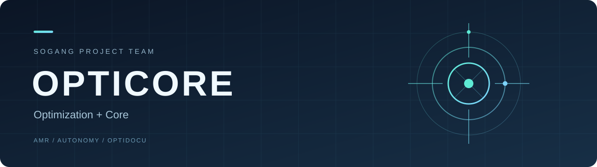

  

  <strong>핵심에 집중하고, 더 나은 해법을 만듭니다.</strong>

## About us

OPTICORE는 Optimization(최적화)과 Core(핵심)를 결합한 이름입니다. 문제의 핵심을 이해하고, 설계와 구현, 검증을 통해 더 나은 해법을 찾아가는 서강대학교 프로젝트 팀입니다.

로봇 시스템, 자율주행, 문서 AI를 함께 탐구하며 프로젝트마다 쌓은 경험을 다음 도전으로 이어갑니다. 이 조직에는 팀의 코드와 문서, 실험과 협업의 기록을 모읍니다.

## Our projects

### [AMR](https://github.com/sogang-opticore/opticore-amr)

**물류 환경에서 여러 로봇이 함께 이동하는 AMR 시스템**

ROS 2와 Gazebo를 기반으로 물류창고 환경, 위치 추정, 객체 인식과 다중 로봇 주행을 연결한 프로젝트입니다. 직접 구현한 A* 전역 경로 계획과 DWA 지역 주행, 카메라 기반 객체 추적, 로봇 간 교착 해소와 우선순위 제어를 다룹니다.

**기여 기록**

| 팀원 | 주요 기여 |
| :--- | :--- |
| 박찬영 | 인식·추적·다중 로봇 기능의 PR 병합과 통합 |
| 박유상 | 창고·동적 장애물·CCTV 시뮬레이션 환경 구성, AMCL·EKF 위치 추정 개선 |
| 양현욱 | 다중 로봇 구성, 교착 해소·우선순위 제어, 센서 융합과 CCTV 기반 장애물 연계 |
| 최지우 | 카메라 기반 객체 추적, 좌표 변환·Kalman Filter, 동적 장애물 구현 |
| 지상원 | A*·DWA 경로 계획과 동적 장애물 회피, 주행 복구·경로 안정화 |

### [AMR Autonomy](https://github.com/sogang-opticore/opticore-amr-autonomy) · 진행 중

**학습 기반 주행과 안전 제어를 비교하는 자율주행 연구**

AMR-Lite 시뮬레이터에서 규칙 기반 주행, 모방학습(BC·DAgger), 강화학습(PPO)을 같은 조건으로 비교하는 프로젝트입니다. 학습 정책의 성능뿐 아니라 Safety Shield의 효과와 실패 상황을 함께 평가합니다.

현재 M1 재현성 기준선과 예측형 Safety Shield 코어를 구현했습니다. 동적 장애물에 대한 안전 제어 검증과 ROS 2·Gazebo 연결이 후속 과제입니다.

**기여 기록**

| 팀원 | 주요 기여 |
| :--- | :--- |
| 양현욱 | AMR-Lite 시뮬레이터·규칙 기반 주행, BC·DAgger·PPO 학습, Safety Shield, 재현성 평가·테스트·실험 문서 구성 |

현재 저장소에서 확인한 구현·실험 커밋을 기준으로 기재했습니다. 후속 개발의 영역별 담당은 팀 논의를 통해 정합니다.

### [OptiDocu](https://github.com/sogang-opticore/opticore-optidocu) · 진행 중 · 비공개

**자동차 부품 공급사의 RFQ 검토와 응답 작성을 돕는 문서 AI**

고객의 견적요청서(RFQ)에서 요구사항을 추출하고, 회사 기준·과거 거래 이력과 부서별 회신을 연결해 근거가 있는 응답 초안을 만드는 산학 캡스톤 프로젝트입니다. 담당자가 웹 화면에서 요구사항별 근거와 미회신·누락·상충·개정·승인 상태를 확인하도록 돕습니다. 가격·납기를 자동으로 확약하지 않으며 최종 판단과 승인은 사람이 맡습니다.

첫 적용 대상은 소형 금속 프레스 부품을 공급하는 가상 2차 협력사입니다. **시험 데이터셋의 제작·검수·공유를 마치고 제품 구현을 준비하는 단계**로, 과거 RFQ 처리 이력 24건과 신규 RFQ 24건(개발 8·평가 16), 접수·회신 취합·제출 전의 72개 시점별 입력을 마련했습니다. 근거답안 72세트와 채점후보 525항목도 입력과 분리해 준비했습니다.

현재 저장소에는 Python 코어의 초기 구조와 설계·평가 문서가 있습니다. AI 분석 엔진, 백엔드 API·데이터베이스, 웹 화면과 파이프라인 연결은 후속 구현 대상이며 모델 성능평가는 아직 실행하지 않았습니다. 데이터 준비 완료와 서비스 구현·평가 완료를 구분합니다.

**현재 역할 — 2026-11-12 확인 WBS 기준**

AI 분석 엔진과 웹 서비스를 나누어 개발하고, 통합·평가와 프로젝트 관리·보고를 함께 진행합니다. 아래 ‘확정 담당’은 책임자가 정해진 작업이며, 완료한 항목만 별도로 표시했습니다. WBS의 점선 항목은 ‘책임자(안)’으로 구분합니다.

| 팀원 | 확정 담당 | 책임자(안) · 팀 확인 전 |
| :--- | :--- | :--- |
| 박찬영 | 착수 문서·제안 발표 **완료**, 최종 발표·완료 보고 | AI 기본 개발, LLM 연결, 중간 점검 |
| 박유상 | 프론트엔드 화면, UI 구성 요소, 계획 수립 | 서버 데이터 관리, 파일 저장, 통합 테스트·기능 동결 |
| 양현욱 | 시험 데이터셋 구축 **완료**, 백엔드 API, 데이터베이스, 파이프라인 연결, 평가 | DB 접근·변경 관리, 개발·시연 서버 |
| 최지우 | 검색·RAG | 챗봇 질의응답, 시연 준비 |
| 지상원 | 문서 처리, 회의록·위키 | 추가 형식 지원 |

**커밋으로 확인한 기여 — 양현욱**

- **개발 기반과 설계 문서:** Python 패키지·모듈 구조를 구성하고 요구사항, 아키텍처, 데이터 정책, 평가 계획과 이슈·PR·회의·진척 템플릿을 정리했습니다. ([초기 구성](https://github.com/sogang-opticore/opticore-optidocu/commit/e4eefb8), [요구사항 정비](https://github.com/sogang-opticore/opticore-optidocu/commit/845932c))
- **업무·데이터 설계:** 공개 자동차 RFQ 자료의 출처와 활용 범위를 정리하고, 가상 회사의 고객·공급사 관계와 제조·품질·원가·승인 기준을 정의했습니다. 이를 과거 24건의 거래 이력과 신규 24건의 RFQ·부서 회신·검토자료로 구체화했습니다. ([참고자료 정리](https://github.com/sogang-opticore/opticore-optidocu/commit/88b399f), [회사 기준](https://github.com/sogang-opticore/opticore-optidocu/commit/ff4861f), [과거 사례](https://github.com/sogang-opticore/opticore-optidocu/commit/5146136))
- **평가 기반과 입력 분리:** 문서 개정·열람 시점·허용 목록을 반영한 72개 입력 묶음과 별도 근거답안·채점후보를 구성했습니다. 평가 정답·작성 해설·미래 문서가 제품 입력에 섞이지 않도록 데이터 사용 기준을 마련했습니다. ([평가자료](https://github.com/sogang-opticore/opticore-optidocu/commit/b14deac), [입력·평가 목록](https://github.com/sogang-opticore/opticore-optidocu/commit/f9acf00))
- **검수와 인계:** 자료의 수치·시점·개정·승인·근거 연결을 검토하고 문서별 작성방법, 버전·해시 목록, 사용안내와 검수 결과를 정리했습니다. 관련 사례 간 독립성 한계와 미확정 배점·합격선도 명시했습니다. ([공유판 검토와 완료 기록](https://github.com/sogang-opticore/opticore-optidocu/commit/338120e))

기여 기록은 현재 저장소의 커밋과 산출물 기준이며, WBS의 담당 배정과 실제 완료 실적을 구분합니다. 가상 데이터의 검수는 실제 기업의 업무 효과나 모델 성능을 검증한 결과가 아닙니다. 비공개 저장소와 위 근거 링크는 접근 권한이 있는 사용자만 열람할 수 있습니다.

## Our team

다섯 명의 팀원이 함께 설계하고 구현합니다.

| 이름 | 역할 | GitHub |
| :--- | :--- | :--- |
| **박찬영** | 팀장 | [@pcycoding](https://github.com/pcycoding) |
| **박유상** | 팀원 | [@us788](https://github.com/us788) |
| **양현욱** | 팀원 | [@ukkhnn](https://github.com/ukkhnn) |
| **최지우** | 팀원 | [@jui-ced](https://github.com/jui-ced) |
| **지상원** | 팀원 | [@Sangwon8799](https://github.com/Sangwon8799) |
